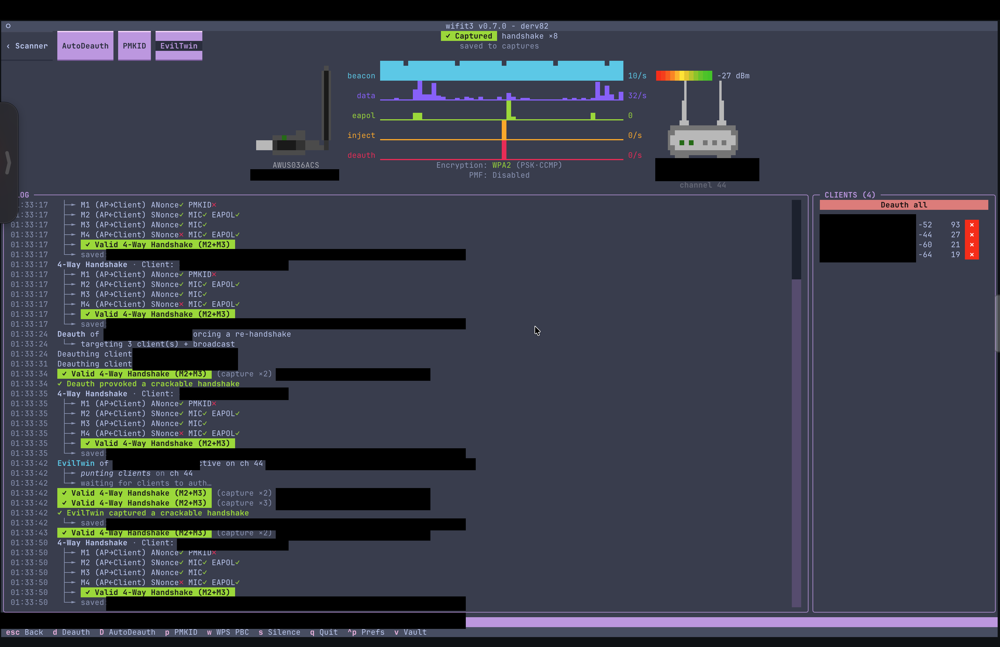
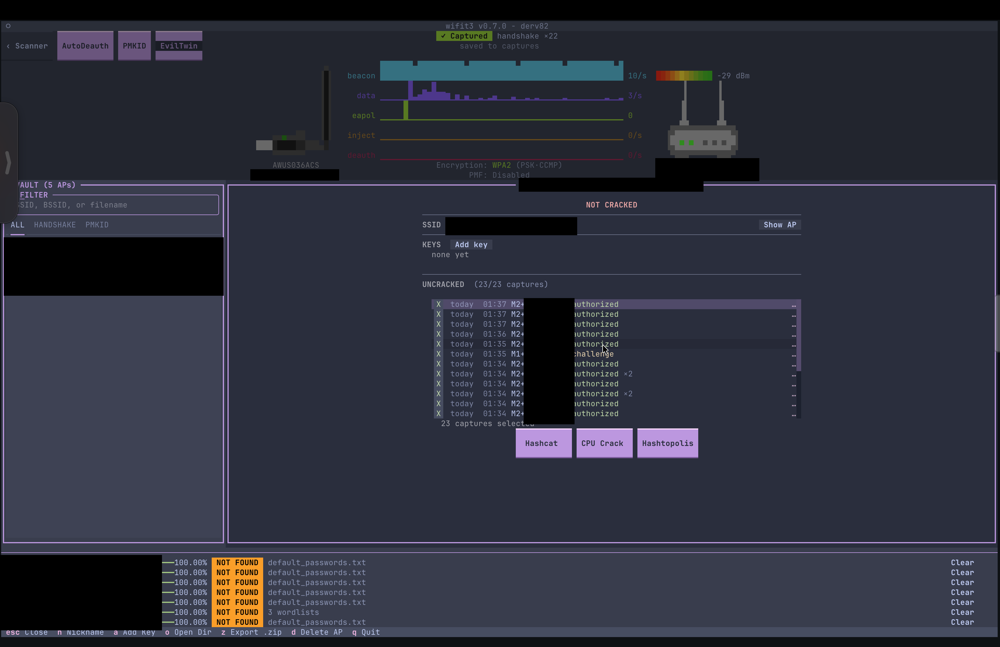
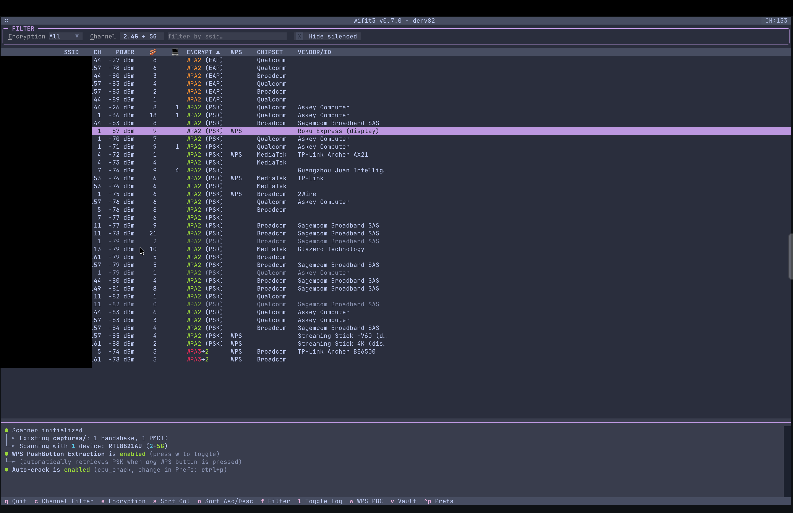
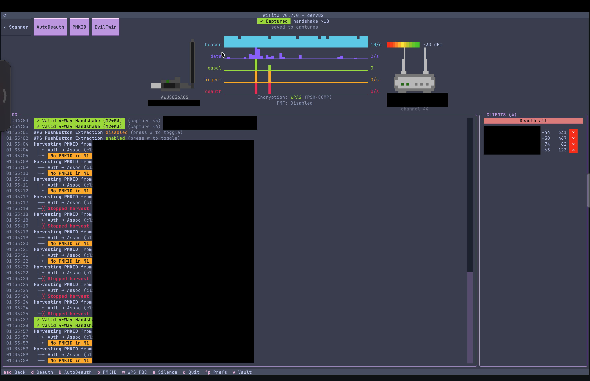
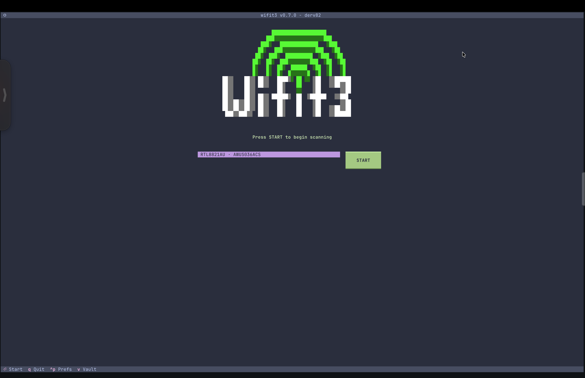

# Maintainer runtime screenshots

These screenshots show **[wifit3 0.7.0 by derv82](https://github.com/derv82/wifit3)** on the maintainer's ALFA AWUS036ACS/macOS setup. wifit3 supplies the terminal interface and its radio operations; alfa-macos packages setup, a Kismet compatibility fix, injection verification, and a separate offline reporting interface.

The maintainer supplied these screenshots and confirmed that deauthentication works on their setup. They are application-level runtime evidence. They do not provide an independently decoded over-air deauthentication packet trace or independently validate the application's handshake classifications. The separate probe-injection test and its response evidence are described in the [README](../README.md#verify-injection-on-your-access-point).

## Deauthentication followed by handshake capture

The visible log records a deauthentication operation, targeted clients, subsequent handshake entries, and **“Deauth provoked a crackable handshake.”** The screen shows the AWUS036ACS, channel 44, and PMF disabled. “Valid 4-Way Handshake (M2+M3)” is wifit3's displayed classification; it should not be read as this repository independently verifying all four messages or their cryptography. No recovered password is shown.

## Saved capture vault

The vault displays saved capture entries and an **UNCRACKED (23/23 captures)** status. Entries may include repeated observations or message pairs; the displayed count is not a count of distinct networks or recovered passwords.

## Scanner

The scanner shows channel, signal, advertised security, and chipset/vendor information. Its log identifies the RTL8821AU driver family and reports existing handshake/PMKID captures. Network names have been masked.

## PMKID attempts

This screenshot records **“No PMKID in M1”** and stopped attempts for the selected AP. It illustrates an unsuccessful PMKID attempt, not proof of successful PMKID acquisition from that AP. Separate handshake captures are visible in the same session.

## Adapter selection

The start screen identifies the AWUS036ACS under wifit3's RTL8821AU driver family. This screen contains no visible network/client identifiers and required metadata removal only.

## Editing and privacy

- Opaque black rectangles replace network names, AP/client/adapter MAC addresses, identifying filenames, and related log/status areas. Some masks cover surrounding text to avoid leaving partial identifiers.
- All five images retain their original dimensions. Decoded RGBA pixel values outside the masks were checked byte-for-byte against the originals. No generative editing, reconstructed text, or added success messages were used.
- EXIF and other ancillary metadata were removed; the generic color profile was retained to preserve appearance.
- The original screenshots and underlying capture/hash files remain private. Only the edited copies are included in this repository.

[Return to the README](../README.md)
